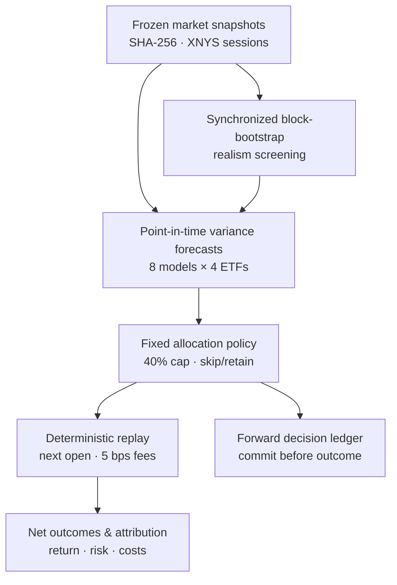

<div align="center">

# 🌊 Ripple

**A reproducible research lab for volatility forecasting, portfolio decisions, and strategy stress testing.**

[](https://github.com/ZenzerJs/Ripple/actions/workflows/offline.yml)
[](pyproject.toml)
[](docs/research-contract.md)
[](.github/workflows/offline.yml)
[](docs/roadmap.md)

*The goal isn't to win a backtest. It's to find out whether a better forecast actually leads to a better decision.*

</div>

---

## 📋 Table of Contents

- [Why Ripple](#-why-ripple)
- [What the Experiments Found](#-what-the-experiments-found)
- [Key Capabilities](#-key-capabilities)
- [Architecture](#-architecture)
- [Research Safeguards](#-research-safeguards)
- [Tech Stack](#-tech-stack)
- [Getting Started](#-getting-started)
- [Research Pipeline](#-research-pipeline)
- [Project Structure](#-project-structure)
- [Limitations & Research Status](#-limitations--research-status)

---

## 💡 Why Ripple

Predicting market volatility is one problem. **Proving that those predictions improve portfolio decisions after costs is another.**

Many financial ML demos stop at a forecast accuracy chart or a profitable backtest. Ripple connects the whole chain: what data was available, what the model predicted, how that prediction changed an allocation, what the trades cost, and where the resulting strategy failed.

| Common backtesting shortcut | Ripple's approach |
|---|---|
| ❌ Train on future-matured labels | ✅ Enforce point-in-time prediction cutoffs and **matured five-session targets** |
| ❌ Call a lower forecast error a trading win | ✅ Compare **eight forecasters through the same fixed allocation policy** |
| ❌ Ignore turnover, spreads, or timing | ✅ Replay **next-session adjusted-open fills** with **5 bps per-side fees** |
| ❌ Hide invalid predictions | ✅ Preserve raw model outputs, flag failures, and apply an explicit **skip-and-retain** rule |
| ❌ Showcase only a favourable market path | ✅ Search for **reproducible failures** in a constrained family of resampled paths |
| ❌ Treat a backtest as live evidence | ✅ Provide a **commit-before-outcome ledger**, with its limits disclosed |

**Research question:** *Do five-session volatility forecasts produce better portfolio decisions than simple risk estimates or equal-weight allocation, after identical trading costs?*

---

## 📊 What the Experiments Found

> [!IMPORTANT]
> **The headline is a negative result for supervised ML, not a claim of outperformance.** In this exploratory 2019–2026 sample, the supervised models tested did **not** improve portfolio utility over the simpler volatility baselines under the predeclared allocation policy. Historical dates overlap prior research; this is **not** an untouched holdout or prospective track record.

### Forecasts → one policy → net portfolio outcomes

All strategies start with **$10,000 virtual capital**. Forecast-driven strategies share a **40%-capped inverse-volatility allocation**, five-session decision schedule, next-open execution, and **0.05% transaction cost per side**.

| Strategy | Final equity | Annualized volatility | Sharpe | Max drawdown | Trading costs |
|---|---:|---:|---:|---:|---:|
| Buy and hold | **$21,879.41** | 12.14% | 0.90 | -21.73% | $5.00 |
| Equal weight (every 5 sessions) | $20,895.13 | 11.63% | 0.88 | -21.05% | $38.89 |
| Trailing 21-session volatility | $19,512.10 | 9.09% | 1.00 | -18.52% | $169.46 |
| EWMA (λ = 0.94) | $19,516.36 | 9.04% | 1.00 | -18.93% | $120.07 |
| GARCH(1,1) | $19,531.43 | **8.97%** | **1.01** | -18.68% | $169.92 |
| Random forest | $18,584.40 | 9.19% | 0.92 | -19.24% | **$402.32** |

<sub>Evaluation: 2019-02-13 to 2026-11-04, 389 scheduled five-session decisions. Selected strategies shown; [full comparison, all eight forecasting models, forecast-error tables, and 2023–2026 subperiod →](docs/phase4b-results.md).</sub>

What this tells us:

1. **Lower risk isn't automatically higher return.** Inverse-volatility allocations reduced portfolio volatility, but their greater bond exposure lagged buy-and-hold and equal-weight in cumulative dollars.
2. **Better model complexity didn't buy better decisions.** GARCH led the forecast-driven policies in this sample; ridge and random forest did not translate their predictions into superior net outcomes.
3. **Trading friction matters.** Random forest generated substantially more turnover and fees than EWMA.
4. **Invalid predictions are evidence.** Some linear models predicted non-positive variance; Ripple recorded those outputs and skipped the affected rebalances instead of silently clipping them.

### Where strategies break

Ripple also searched **18 synchronized multi-asset block-bootstrap scenarios** using block lengths of 5, 10, and 21 sessions. The empirical realism screen marked **15 valid** and **3 borderline**.

One reproducible scenario, `search_b5_s104`, repeatedly favoured equities, gold, and REITs while low-volatility Treasuries lagged. Relative to five-session equal weight:

| Strategy | Difference in cumulative net return | Annualized volatility |
|---|---:|---:|
| Trailing volatility | **-43.89 percentage points** | 8.11% |
| EWMA | -40.63 percentage points | 8.08% |
| HAR-OLS | **-49.68 percentage points** | 8.06% |
| Equal weight | Reference | 9.55% |

The stressed risk-based strategies had **lower volatility yet materially lower returns** in that scenario. These are failure cases **within the defined resampling family**, not forecasts of future market events.

**Evidence:** [Phase 4 empirical report](docs/phase4b-results.md) · [Phase 5 stress report](docs/phase5-stress-results.md) · [Research contract](docs/research-contract.md)

---

## ✨ Key Capabilities

| Component | What it does |
|---|---|
| 🕰️ **Deterministic replay** | Simulates cash, holdings, orders, fills, fees, equity, turnover, and drawdown without network access during replay. |
| 🧠 **Eight variance forecasters** | Tests persistence, rolling volatility, EWMA, GARCH, HAR-OLS, ridge, random forest, and extended ridge across **SPY / IEF / GLD / VNQ**. |
| ⚖️ **Controlled portfolio experiment** | Uses one inverse-volatility policy with a 40% asset cap; holds execution, timing, costs, and fallback behaviour constant across models. |
| 🧪 **Constrained stress search** | Resamples synchronized cross-asset OHLC behaviour, screens scenarios for empirical plausibility, and recomputes the forecast-to-replay pipeline. |
| 🔗 **Forward-decision ledger primitives** | Records decisions in an append-only, hash-chained JSONL format; verifies event order, missed runs, retries, and tampering. |
| 🔍 **Audit artifacts & tests** | Produces data/configuration/source hashes and reports; CI runs deterministic offline tests, linting, and a synthetic demo. |

### 🚫 What Ripple does not do

- **No brokerage integration or real-money execution.**
- **No prediction of political events, wars, or supply shocks.** Stress paths are resampled market behaviour, not a causal simulator of the economy.
- **No hidden repair of invalid forecasts.** Non-positive predictions and failed fits remain visible in the audit trail.
- **No guarantee of market-beating returns.** The current results include strategies that underperform simpler baselines.

---

## 🏗️ Architecture



Stress runs rebuild features, forecasts, decisions, and trades on each candidate path. The comparison engine never gives one forecaster a different allocation policy or fee schedule.

See [architecture](docs/architecture.md), [data contract](docs/data-contract.md), and the [Phase 4 decision record](docs/decisions/002-phase4-experiment-contract.md).

---

## 🔒 Research Safeguards

| Safeguard | Enforced rule |
|---|---|
| **Observation availability** | A session is treated as available at the following New York midnight; decisions cannot use subsequent market sessions. |
| **Label maturity** | A supervised five-session target must finish maturing **before** its training cutoff; chronological train windows are required. |
| **Train-only transforms** | Feature scalers are fitted on training rows, never the evaluation rows. |
| **Shared execution** | All strategies trade only at the next session's adjusted open, with the same fees, capital, long-only rules, and calendar. |
| **Failure transparency** | Invalid/nonconverged predictions are tracked, raw forecasts are preserved, and rebalance skips are counted. |
| **Scenario provenance** | Stress seeds, block lengths, dataset hashes, realism verdicts, and relative failures are recorded. |
| **Ledger integrity** | Hash-chain verification detects local history changes, but **does not independently prove wall-clock timestamps or uninterrupted operation**. |

---

## 🧱 Tech Stack

| Layer | Tools |
|---|---|
| Core research | **Python 3.12**, NumPy, pandas |
| Forecasting | scikit-learn, `arch` (GARCH) |
| Market calendar & ingestion | `exchange_calendars`, `yfinance` |
| Reproducibility | `uv` lockfile, SHA-256 manifests, frozen local snapshots |
| Quality gates | **pytest**, **Ruff**, GitHub Actions |
| Reporting | CSV/JSON artifacts and Matplotlib |

No paid inference APIs, hosted database, or frontend are required.

---

## 🚀 Getting Started

**Prerequisites:** Python 3.12 and [`uv`](https://docs.astral.sh/uv/getting-started/installation/).

```bash
git clone https://github.com/ZenzerJs/Ripple.git
cd Ripple

# Restore exact locked dependencies
uv sync --frozen

# Run the deterministic, network-free synthetic demonstration
uv run --frozen ripple demo

# Verify the offline code paths
uv run --frozen pytest tests -q
uv run --frozen ruff check src tests
```

The demo writes locally under `artifacts/synthetic/demo/`. CI performs the same class of offline checks using committed fixtures; it does **not** need to download historical Yahoo data.

---

## 🔬 Research Pipeline

Historical snapshots and generated artifacts live in ignored local directories. The published reports document their source hashes; downloading fresh data later may produce a **different** adjusted historical snapshot.

<details>
<summary><strong>1. Acquire & validate the historical data</strong></summary>

```bash
uv run --frozen ripple data fetch --output data/snapshots/2016-2026 --start 2016-01-04 --end-exclusive 2026-11-05
```

Four ETFs: `SPY` (equities), `IEF` (Treasuries), `GLD` (gold), and `VNQ` (REITs). Data are aligned to `XNYS` sessions and checked against snapshot hashes.

</details>

<details>
<summary><strong>2. Generate five-session volatility forecasts</strong></summary>

```bash
uv run --frozen ripple forecast --snapshot data/snapshots/2016-2026 --output artifacts/forecasts/2016-2026
```

</details>

<details>
<summary><strong>3. Compare portfolio decisions after costs</strong></summary>

```bash
uv run --frozen ripple compare-forecasts --snapshot data/snapshots/2016-2026 --forecasts artifacts/forecasts/2016-2026 --output artifacts/historical/phase4b-2019-2026
```

</details>

<details>
<summary><strong>4. Search for stress scenarios</strong></summary>

```bash
uv run --frozen ripple stress --snapshot data/snapshots/2016-2026 --output artifacts/stress/2016-2026
```

</details>

<details>
<summary><strong>5. Demonstrate the forward-ledger workflow</strong></summary>

```bash
uv run --frozen ripple ledger commit-latest --forecasts artifacts/forecasts/2016-2026 --model ewma094 --ledger artifacts/forward/ledger.jsonl
uv run --frozen ripple ledger verify --ledger artifacts/forward/ledger.jsonl
```

**Important:** Committing a decision based on an already-known historical forecast is only a ledger demonstration. A genuine prospective track record requires decisions logged at the actual decision time, subsequent outcomes recorded later, explicit missed-run records, and ideally independent timestamp anchoring. No continuously operating forward-test service is claimed here.

</details>

---

## 📁 Project Structure

```text
Ripple/
├── src/ripple/
│   ├── data/          # Acquisition, snapshots, session/availability rules
│   ├── forecasts/     # Eight models, schemas, and frozen forecast bundles
│   ├── policies/      # Fixed allocation rule and invalid-forecast handling
│   ├── strategies/    # Buy-and-hold, equal weight, trailing-vol, forecast policy
│   ├── simulation/    # Self-financing execution ledger and replay
│   ├── evaluation/    # Comparison, metrics, and bootstrap analysis
│   ├── stress/        # Block resampling, realism checks, failure search
│   └── ledger/        # Prospective event-chain primitives
├── tests/             # Deterministic offline and boundary tests
├── docs/              # Research contracts, decisions, results, roadmap
├── configs/           # Frozen replay configuration
└── .github/workflows/ # Offline CI
```

**Further reading:** [Research protocol](docs/research-protocol.md) · [Learning guide](docs/learning-guide.md) · [Roadmap](docs/roadmap.md) · [Implementation plan](Ripple_Implementation_Plan.md)

---

## 🎓 Limitations & Research Status

> **Honest evaluation over impressive charts.**

- **Phases 3–6 are implemented as offline research components.** The historical replay, multi-ETF forecast comparisons, constrained stress search, and ledger primitives are in the repository.
- **Results are exploratory.** The predecessor project and the Phase 3 replay already inspected overlapping historical periods. A new, independently recorded forward sample is needed for stronger out-of-sample claims.
- **Prices are adjusted retrospectively.** Yahoo's adjusted OHLC series approximates total-return units, **not actual executable ETF shares or point-in-time market-data vintages**. Next-open fills and 5 bps fees are modelling assumptions, not a broker-execution guarantee.
- **The fuzzer tests a defined scenario family.** Passing empirical realism checks does not establish that a path is the most adverse possible, economically causal, or likely.
- **The forward ledger is not external timestamp proof.** Its chain supports tamper detection and event-order auditing; durable external anchoring and scheduled operational evidence are separate future work.

Ripple is research software, **not investment advice or an automated trading system**.

<div align="center">

*Built by [@ZenzerJs](https://github.com/ZenzerJs) · Predecessor research: [ML-Stock-Simulator](https://github.com/ZenzerJs/ML-Stock-Simulator)*

</div>
