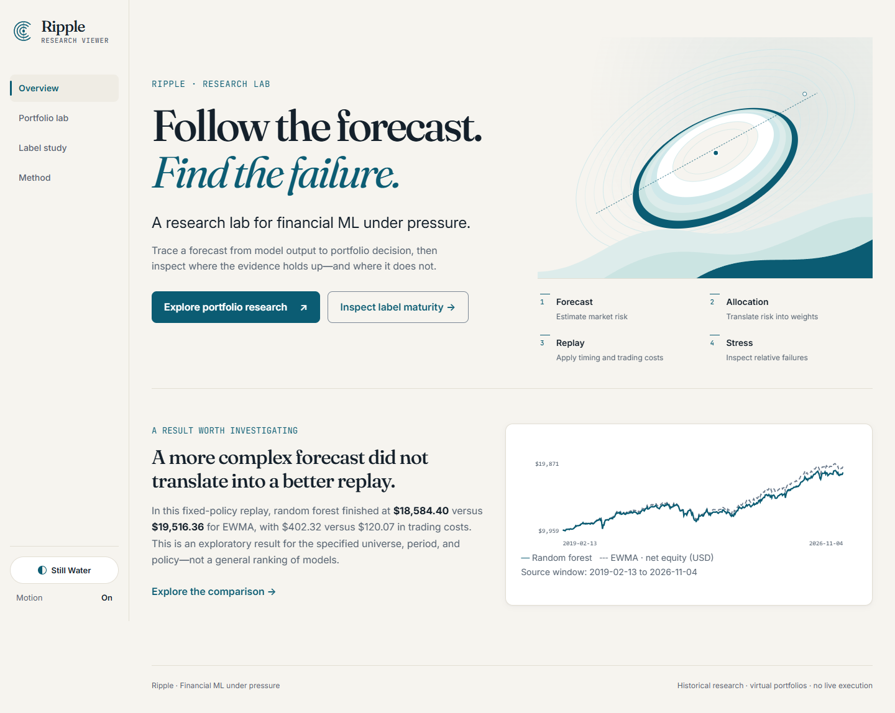
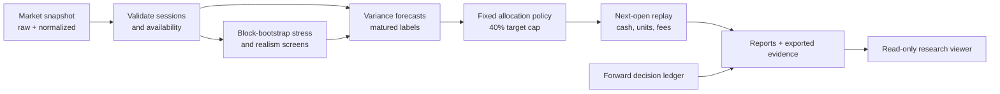

<div align="center">

# 🌊 Ripple

**Follow the forecast. Find the failure.**

A research lab for **volatility forecasts, portfolio decisions, and the cases where a strategy falls short**.

[](https://github.com/ZenzerJs/Ripple/actions/workflows/offline.yml)
[](https://zenzerjs.github.io/Ripple/)
[](pyproject.toml)
[](frontend/package.json)
[](.github/workflows/offline.yml)

**[Explore the research viewer](https://zenzerjs.github.io/Ripple/)** · [Research contract](docs/research-contract.md) · [Results](docs/phase4b-results.md)



</div>

---

## 📋 Contents

- [Why Ripple](#-why-ripple)
- [What the Evidence Says](#-what-the-evidence-says)
- [Key Capabilities](#-key-capabilities)
- [Architecture](#-architecture)
- [The Label-Maturity Experiment](#-the-label-maturity-experiment)
- [Tech Stack](#-tech-stack)
- [Getting Started](#-getting-started)
- [Repository Layout](#-repository-layout)
- [Limits and Interpretation](#-limits-and-interpretation)

---

## 💡 Why Ripple

A forecast can look accurate and still lead to a weaker portfolio. Ripple traces that forecast through an allocation policy, trading costs, and historical replay, then keeps the awkward outcomes visible.

**Research question:** Do five-session volatility forecasts improve portfolio decisions after identical trading costs?

Ripple compares forecast-driven allocations against simpler baselines on the same four-ETF universe. It records unavailable predictions and skipped decisions instead of silently turning them into successful results.

## 📊 What the Evidence Says

> [!IMPORTANT]
> **Published exploratory replay:** In this 2019–2026 comparison, the supervised ML strategies did not improve portfolio utility over simpler baselines. The research overlaps previously inspected data; it is not an untouched holdout or a prospective track record.

| Strategy | Final equity | Net return | Trading costs |
|---|---:|---:|---:|
| Equal weight, rebalanced every five sessions | $20,895.13 | 108.95% | $38.89 |
| EWMA volatility forecast | $19,516.36 | 95.16% | $120.07 |
| Random forest volatility forecast | $18,584.40 | 85.84% | $402.32 |

Each strategy starts with **$10,000 virtual cash**. Results cover SPY, IEF, GLD, and VNQ from **2019-02-13 to 2026-11-04**, using next-session adjusted-open execution and **5 basis points per side**. These figures describe this specific replay, not a general ranking of models. [Full comparison and methodology](docs/phase4b-results.md).

The [stress search](docs/phase5-stress-results.md) explores a bounded family of resampled paths. Its worst cases are diagnostic scenarios, not predictions of future markets.

## ✨ Key Capabilities

| Component | What it provides |
|---|---|
| 📥 **Snapshot and market data** | Local, hash-checked snapshots and a validated exchange-session calendar. |
| 🔮 **Forecast research** | Five-session variance forecasters, label maturity rules, train-only preprocessing, and explicit invalid predictions. |
| ⚖️ **Portfolio replay** | A fixed, 40%-capped inverse-volatility allocation policy with next-open fills, trading fees, and cash-and-unit accounting. |
| 🌪️ **Stress search** | Synchronized multi-asset block-bootstrap paths, realism screening, and separate search and validation seeds. |
| 🧾 **Forward ledger** | Hash-chained decision records, retry handling, and commit-before-outcome checks. |
| 🔎 **Interactive viewer** | Portfolio comparisons, label-maturity diagnostics, fold-level tables, and provenance details in a read-only interface. |

## 🏗️ Architecture



[Architecture overview](docs/architecture.md) · [Data contract](docs/data-contract.md) · [Simulation contract](docs/simulation-contract.md) · [Research protocol](docs/research-protocol.md)

## 🔬 The Label-Maturity Experiment

The monthly label study is a **controlled reimplementation**, separate from the five-session portfolio study. Its unpurged reference excludes the forecast row but may include prior labels that have not matured. The matured-label variant removes those rows. It does **not** execute the complete ML Stock Simulator pipeline.

An earlier export mistakenly trained the reference on the forecast row itself. Its **+2.41 percentage point headline was withdrawn**; the current exports use the corrected boundary. Skipped folds remain visible with their reason. The filtered “Skipped / non-OK” view shows exceptions only, so its rows are not representative of all folds.

“Export integrity checked” means the file bytes match the index hash; it does not independently prove data provenance or validate a research claim. [Experiment method and reproduction](docs/viewer-experiment.md).

## 🧱 Tech Stack

| Layer | Technology |
|---|---|
| Research and replay | Python 3.12, NumPy, pandas, scikit-learn, exchange-calendars |
| Market snapshots | yfinance acquisition, normalized CSV, SHA-256 manifests |
| Research viewer | Next.js 15, React 19, TypeScript, Tailwind CSS |
| Artwork | Editable Typst source with committed SVG exports |
| Verification | pytest, Ruff, Vitest, Playwright, GitHub Actions |
| Publication | Static GitHub Pages viewer and checked-in JSON exports |

## 🚀 Getting Started

### Explore the viewer locally

```bash
git clone https://github.com/ZenzerJs/Ripple.git
cd Ripple/frontend
npm ci
npm run dev
```

Open [http://localhost:3000](http://localhost:3000). The viewer reads checked-in exports; it does not rerun the research when the page loads.

### Run the offline research checks

Requires **Python 3.12** and [uv](https://docs.astral.sh/uv/). From the repository root:

```bash
uv sync --frozen
uv run pytest tests -q
uv run ruff check src tests
uv run ripple demo
```

The demo uses synthetic data and runs offline. For frontend verification, run `npm run typecheck`, `npm test`, `npm run build`, and `npm run test:e2e` from `frontend/`.

### Reproduce a historical run

Historical acquisition needs network access; replay reads the resulting local snapshot. A newly downloaded snapshot can differ from the published one if the data provider revises historical prices.

```bash
uv run ripple data fetch --output data/snapshots/2016-2026 --start 2016-01-04 --end-exclusive 2026-11-05
uv run ripple forecast --snapshot data/snapshots/2016-2026 --output artifacts/forecasts/2016-2026
uv run ripple compare-forecasts --snapshot data/snapshots/2016-2026 --forecasts artifacts/forecasts/2016-2026 --output artifacts/historical/phase4b-2019-2026
uv run ripple stress --snapshot data/snapshots/2016-2026 --output artifacts/stress/2016-2026
```

See the [research contract](docs/research-contract.md) and [viewer experiment guide](docs/viewer-experiment.md) for boundaries, fixtures, and export details.

## 📁 Repository Layout

```text
Ripple/
├── src/ripple/
│   ├── data/          # Snapshot acquisition and market sessions
│   ├── forecasts/     # Forecast models and contracts
│   ├── policies/      # Allocation rules
│   ├── simulation/    # Portfolio replay
│   ├── stress/        # Resampled scenarios and screening
│   └── ledger/        # Forward decision records
├── frontend/          # Research viewer, exports, and browser tests
├── tests/             # Offline research and replay tests
├── docs/              # Contracts, reports, and design notes
├── design/typst/      # Editable Ripple artwork
└── .github/workflows/ # Checks and Pages deployment
```

## 🎓 Limits and Interpretation

- **Historical data:** Adjusted prices model total-return units, not executable ETF shares or archived point-in-time vintages.
- **Research scope:** This universe, period, allocation policy, and cost model constrain the findings. Previously inspected data are not an untouched holdout.
- **Stress search:** Results apply to the declared resampling family and realism screens, not every possible market scenario.
- **Ledger:** Hash-chain checks detect inconsistencies but do not independently prove timestamps or uninterrupted operation. Existing historical commitments are demonstrations.
- **Execution:** Ripple is a research system; no broker connection or real-money execution is implemented.

[Learning guide](docs/learning-guide.md) · [Roadmap](docs/roadmap.md) · [Predecessor project](https://github.com/ZenzerJs/ML-Stock-Simulator)

<div align="center">

*Built by [@ZenzerJs](https://github.com/ZenzerJs)*

</div>
